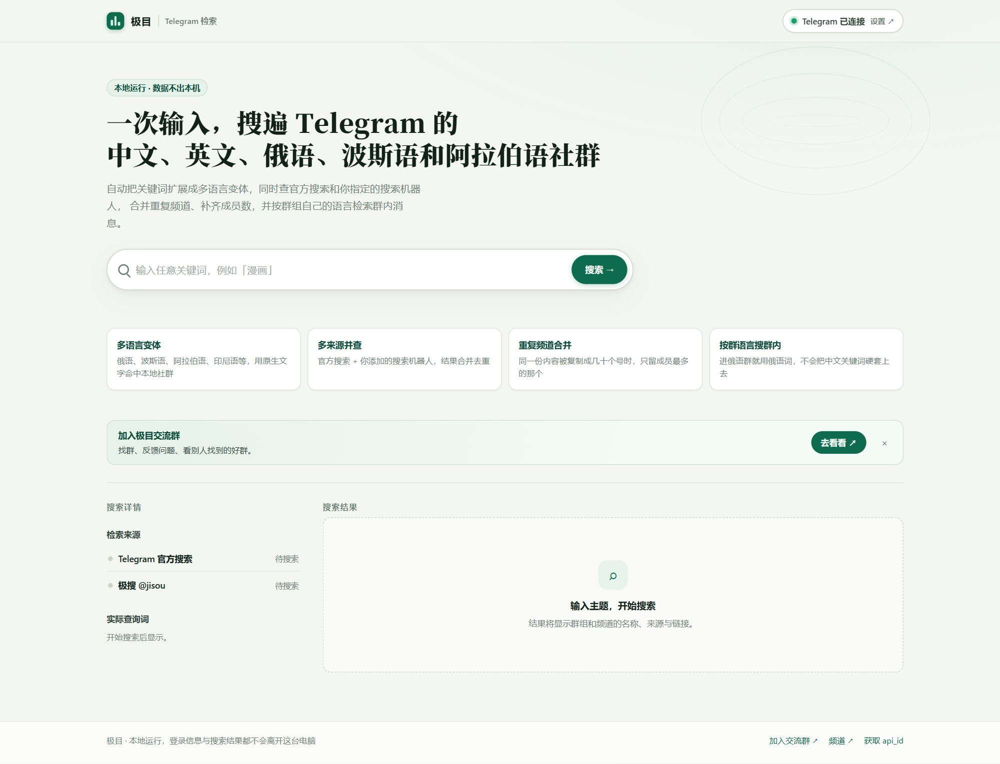

# Jimu · Telegram Group Search

[简体中文](README.md) | [English](README.en.md)

> Search Telegram communities in Chinese, English, Russian, Persian, and Arabic with one query.

**Jimu (极目)** is a local Telegram group and channel search tool. It runs on your own computer and signs in with
your own account. Your session, search history, and results stay on your computer—not on a Jimu server.
Search terms and expanded keywords are sent to Telegram. If you configure an online AI provider, the original
search term is also sent to that provider. Jimu searches Telegram's official index and search bots you choose,
merges duplicate channels, enriches member counts, and searches messages using each chat's language.

> You can customize the app name and your group/channel links under **Settings → Branding & promotion**.



## Why Jimu

| Feature | What it does |
|---|---|
| **Multilingual query expansion** | Adds native-script Russian, Persian, Arabic, and other language variants. Edit the language list yourself; Chinese language names are accepted. |
| **Multiple search sources** | Searches Telegram's official index and your selected search bots, then merges results by link. |
| **Duplicate-channel merging** | When promoters clone the same content across many accounts, keeps the copy with the most members and merges its sources and matched terms. |
| **Chat-language message search** | Searches a Russian chat with Russian terms instead of forcing Chinese keywords into it. The actual terms are shown. |
| **Adjustable ranking** | Use balanced ranking or favor a source. This reorders results; it does not remove them. |
| **Metadata enrichment** | Fills in member counts and descriptions when available. |
| **Local-first** | Sessions, history, and ranking stay local. Search requests go to Telegram; AI receives only the original query. |
| **Portable Windows build** | Includes Python and dependencies. Unzip and run; no Python installation required. |

## Quick start

### Option 1: Portable Windows package

1. Download `jimu-telegram-search-windows-portable.zip` from [Releases](https://github.com/fuyou1998/telegram-search/releases) and unzip it.
2. Run `1-登录.cmd` and enter your Telegram API ID/hash, proxy if needed, phone number, and code.
3. Run `2-启动搜索.cmd`. Jimu opens in your browser.

Python and all dependencies are bundled. On first launch, Jimu creates a desktop and Start Menu shortcut.
If you move the folder later, run `3-创建快捷方式.cmd` to update the shortcut.

### Option 2: Run from source

Requires Python 3.11 or newer. The install script creates a virtual environment and installs dependencies.

**Windows**

```bat
git clone https://github.com/fuyou1998/telegram-search.git
cd telegram-search
start-search.cmd
```

Then run `telegram-login.cmd` once to sign in.

**macOS / Linux**

```sh
git clone https://github.com/fuyou1998/telegram-search.git
cd telegram-search
bash install.sh
```

Use `login.command` to sign in and `start.command` to launch Jimu and open the browser.
If double-clicking does nothing, run `chmod +x *.command`. On macOS, if Gatekeeper blocks the scripts,
run `xattr -cr .` in the project folder and try again.

You can also install and launch manually:

```sh
python3 -m venv .venv
.venv/bin/pip install -r requirements.txt
.venv/bin/python telegram_login.py
.venv/bin/python launcher.py
```

### What you need for first use

- **Telegram API ID and hash**: Apply at [my.telegram.org/apps](https://my.telegram.org/apps); it takes about two minutes.
- **A Telegram account**: Login codes are delivered to an already signed-in Telegram client, not necessarily by SMS.
- **A proxy**: Usually required on networks that cannot reach Telegram directly. Find your accelerator's local port
  (often 7890, 7897, or 1080) and enter `socks5://127.0.0.1:PORT` or `http://127.0.0.1:PORT`.

## Configuration

All settings can be changed in the web UI under **Settings**, or in `.env`:

| Variable | Description |
|---|---|
| `TELEGRAM_API_ID` / `TELEGRAM_API_HASH` | App credentials from my.telegram.org |
| `TELEGRAM_PROXY_URL` | SOCKS5 or HTTP proxy; blank means direct connection |
| `TELEGRAM_SEARCH_BOTS` | Comma-separated bot usernames; defaults to `@jisou`, up to 5 |
| `TELEGRAM_OFFICIAL_SEARCH` | Also use Telegram's official search; default `1` |
| `TELEGRAM_BOT_VARIANTS` | Query variants sent to each bot; default `4` |
| `TELEGRAM_MAX_VARIANTS` | Maximum variants per search; default `14` |
| `TELEGRAM_ENRICH` | Enrich member counts and descriptions; default `1` |
| `AI_BASE_URL` / `AI_MODEL` / `AI_API_KEY` | OpenAI-compatible query expansion; optional |
| `AI_LANGUAGES` | Comma- or ideographic-comma-separated language list; defaults to 20 languages |
| `AI_LANGUAGE_COUNT` | Maximum languages per query; default `5`, range `1–10` |
| `AI_REASONING_EFFORT` | Optional `low` setting for providers that support it |
| `APP_BRAND` | Display name; defaults to Jimu / 极目 |
| `PROMO_TITLE` / `PROMO_TEXT` / `PROMO_URL` | Optional dismissible homepage group promotion |
| `PROMO_CHANNEL` | Optional channel link shown in the footer |

`TELEGRAM_*` settings rebuild the Telegram client and apply to the next search. AI settings apply to the next search.

## How it works

```text
Browser → Local FastAPI service (127.0.0.1:8787)
             ├─ Optional AI expands one query into multilingual variants (cached for 30 minutes)
             ├─ Telegram official search ──┐
             └─ Selected search bots ──────┴─> merge, deduplicate, enrich, rank
                       └─ Your MTProto session stays on this computer
```

Observed search semantics reflected in the implementation:

- Official search behaves like **AND**: every term must match. Channel discovery limits each variant to two terms.
- **Two terms** work best for channel discovery; a single Chinese word often returns no channels.
- **One term** tends to recall more messages. In-chat search prioritizes shorter queries.
- Some bots are not AND searches and may return a fixed promo block when nothing matches. Jimu recognizes and skips that block.

## Compare against manual search

`compare.py` compares Jimu's results with one search in Telegram's own search box:

```bat
python compare.py "VPN 推荐" "crypto trading bot" --csv reports\compare.csv
```

The report shows result counts, overlap, recall, new and missed results, language coverage, and ranking changes.
You can also provide your own manually collected baseline:

```json
{ "VPN 推荐": ["https://t.me/ankrovpn_reviews", "https://t.me/gfwoff"] }
```

```bat
python compare.py --topics topics.txt --baseline manual.json
```

## Build the portable package

```bat
python build_portable.py
```

This creates `dist\Telegram搜索-便携版.zip` (about 28 MB) with embedded Python 3.13 and all dependencies.
The build excludes `.env` and `.telegram-data`, so credentials and sessions are never packaged.

## Customize the group promotion

Set your app name, Telegram group, and channel under **Settings → Branding & promotion**, or in `.env`:

```ini
APP_BRAND=Jimu
PROMO_TITLE=Join the Jimu community
PROMO_TEXT=Find groups, share feedback, and recommend useful communities.
PROMO_URL=https://t.me/jimu_group
PROMO_CHANNEL=https://t.me/jimu_feed
```

The group link appears in a dismissible homepage banner and the footer; the channel link appears in the footer.

## Troubleshooting

**Telegram is not connected**

Use **Settings → Network proxy → Detect automatically**. If you use Clash/FlClash TUN mode, leave the app-level proxy blank
to avoid double-proxying. If using a local proxy port, enter it explicitly. The Windows system-proxy toggle alone may not
route Telegram's MTProto traffic.

**No results**

Check the source status in the left panel. Search bots can rate-limit requests; wait a few minutes and retry.

**AI expansion is unavailable**

Jimu falls back to local keyword splitting. Configure an OpenAI-compatible provider to get more multilingual variants.

**Will my account be banned?**

Jimu uses your account for ordinary search requests. High-frequency automated use can carry account risk; do not use it
for bulk scraping.

**Does it run outside Windows?**

The source setup supports macOS and Linux. The portable package is Windows-only.

## Project structure

```text
server.py          FastAPI service and API
telegram_source.py Telegram official, bot, and in-chat search
search_quality.py  Query expansion, language detection, deduplication, and ranking
settings.py        Local .env settings
history.py         Search history, query cache, and query statistics (SQLite)
proxy_probe.py     Local proxy detection with Telegram TLS verification
compare.py         Comparison against manual Telegram search
build_portable.py  Windows portable package builder
make_icon.py       Dependency-free icon generator
create-shortcuts.ps1 Desktop and Start Menu shortcuts
install.sh         macOS/Linux one-step setup
static/            Web UI
```

## Disclaimer

This project searches public groups and channels only. It does not bypass access controls or proxy other people's
accounts. Follow Telegram's terms and applicable laws; use it at your own risk.

## License

[MIT](LICENSE)
