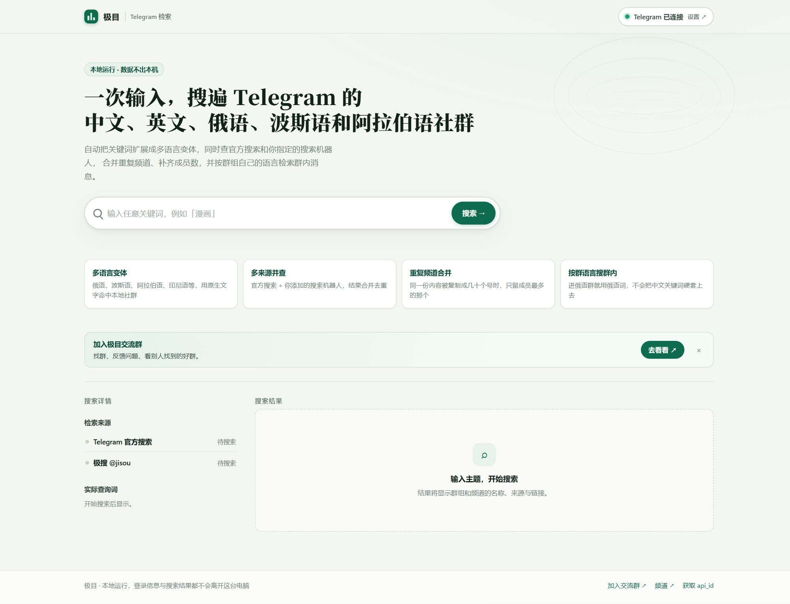

# 极目 · Telegram（电报）群组检索

[简体中文](README.md) | [English](README.en.md)

English README: [README.en.md](README.en.md)

> 一次输入，同时搜遍 Telegram（电报）上的中文、英文、俄语、波斯语、阿拉伯语社群。

**极目**（Jí Mù）是一个**本地运行**的 Telegram 群组/频道检索工具：用你自己的账号登录，在你自己的电脑上运行。
账号会话、搜索历史和结果保存在本机，不经过本项目的服务器。搜索词和扩展后的关键词会发送给 Telegram；
配置在线 AI 时，原始搜索词也会发送给你选择的 AI 服务。使用 `channel_card.py --ai` 时，
该公开频道的简介和近期公开帖样本也会发给 AI 生成介绍。工具会同时查官方搜索和你指定的搜索机器人，
合并重复频道、补齐成员数，还能按群组自己的语言去翻群内消息。

> 名字、频道链接都可以在页面的「设置 › 品牌与推广」里改成你自己的。



## 为什么用它

| 能力 | 说明 |
|---|---|
| **多语言变体** | 中文查询会自动补出俄语、波斯语、阿拉伯语等变体，用原生文字命中本地社群。语言列表可以自己改，写中文名也行。 |
| **多来源并查** | Telegram 官方搜索 + 极搜等搜索机器人同时跑，结果按链接合并去重。 |
| **重复频道合并** | 推广号把同一份内容复制成几十个账号时，只保留成员最多的那个，来源和命中词都合并进去。 |
| **按群语言搜群内** | 进俄语频道就用俄语词检索，不会把中文关键词硬套上去。检索用词在界面上可见。 |
| **排序权重可调** | 均衡 / 偏向某个来源，随时切换，只改排序不删结果。 |
| **元数据补齐** | 自动补成员数和简介，排序和判断活跃度都更准。 |
| **本地优先** | 登录会话、历史记录和排序都在本机；搜索请求发给 Telegram，AI 扩词只收原始搜索词。 |
| **零安装分发** | 内置 Python 的便携包，别人解压双击就能用，不需要装任何东西。 |

## 快速开始

### 方式一：便携包（推荐给不折腾环境的人）

1. 到 [Releases](https://github.com/fuyou1998/telegram-search/releases) 下载 `jimu-telegram-search-windows-portable.zip`，解压。
2. 双击 `1-登录.cmd`，按提示填入 App api_id、api_hash、代理（可跳过）、手机号和验证码。
3. 双击 `2-启动搜索.cmd`，浏览器会自动打开页面。

包里已经带好 Python 和全部依赖，不需要安装任何东西。
第一次启动会自动在**桌面和开始菜单**创建「极目」快捷方式（放大镜图标），以后直接点它就行。
移动文件夹后运行一次 `3-创建快捷方式.cmd` 更新路径。

### 方式二：源码运行

需要 Python 3.11+（安装脚本会自己建虚拟环境和装依赖）。

**Windows**

```bat
git clone https://github.com/fuyou1998/telegram-search.git
cd telegram-search
start-search.cmd        REM 首次会自动装依赖；然后双击 telegram-login.cmd 登录
```

**macOS / Linux**（一行搞定）

```sh
git clone https://github.com/fuyou1998/telegram-search.git && cd telegram-search
bash install.sh
```

安装完会得到两个可双击的入口：`login.command`（登录一次）和 `start.command`（启动并打开浏览器）。
如果双击没反应，先执行 `chmod +x *.command`——有些解压工具会丢掉可执行权限。
如果 macOS 提示「无法打开，因为它来自身份不明的开发者」，在项目目录执行 `xattr -cr .` 后重试。

也可以手动来：

```sh
python3 -m venv .venv
.venv/bin/pip install -r requirements.txt
.venv/bin/python telegram_login.py
.venv/bin/python launcher.py
```

### 第一次使用要准备什么

- **App api_id / api_hash**：到 [my.telegram.org/apps](https://my.telegram.org/apps) 免费申请，约两分钟。
- **一个 Telegram 账号**：用于检索。验证码会发到你已登录的 Telegram 客户端，不是短信。
- **代理**：国内网络必须填。打开机场/加速器找「本地端口」（常见 7890、7897、1080），
  填成 `socks5://127.0.0.1:端口` 或 `http://127.0.0.1:端口`。

## 配置

网页右上角「设置」里都能改，也可以直接编辑 `.env`：

| 变量 | 说明 |
|---|---|
| `TELEGRAM_API_ID` / `TELEGRAM_API_HASH` | 应用凭据，my.telegram.org 申请 |
| `TELEGRAM_PROXY_URL` | SOCKS5 / HTTP 代理，留空直连 |
| `TELEGRAM_SEARCH_BOTS` | 逗号分隔的搜索机器人，默认 `@jisou`，最多 5 个 |
| `TELEGRAM_OFFICIAL_SEARCH` | 是否同时使用官方搜索，默认 `1` |
| `TELEGRAM_BOT_VARIANTS` | 每个机器人检索几个关键词，默认 `4` |
| `TELEGRAM_MAX_VARIANTS` | 单次搜索最多用几个变体，默认 `14` |
| `TELEGRAM_ENRICH` | 是否补齐成员数与简介，默认 `1` |
| `AI_BASE_URL` / `AI_MODEL` / `AI_API_KEY` | OpenAI 兼容接口，用于关键词扩展；不填也能用 |
| `AI_LANGUAGES` | 关键词要覆盖的语言，逗号或顿号分隔，默认 20 种 Telegram 主要语言 |
| `AI_LANGUAGE_COUNT` | 每个关键词最多翻成几种语言，默认 `5`（1–10） |
| `AI_REASONING_EFFORT` | 可选，`low` 可让单次扩展更快（需服务商支持） |
| `APP_BRAND` | 页面显示的名字，默认「极目」 |
| `PROMO_TITLE` / `PROMO_TEXT` / `PROMO_URL` | 首页推广位：填了就在页面顶部显示一条可关闭的推荐，`PROMO_URL` 是交流群链接 |
| `PROMO_CHANNEL` | 频道链接，显示在页脚 |

改 `TELEGRAM_*` 会重建连接，下一次搜索生效；AI 配置下一次搜索生效。

## 工作原理

```
浏览器 ──> 本地服务（FastAPI, 127.0.0.1:8787）
                │
                ├─ 关键词扩展：在线 AI 生成多语言变体（可缓存 30 分钟）
                │
                ├─ Telegram 官方搜索 ──┐
                └─ 搜索机器人 @jisou ──┴─> 合并、去重、补齐元数据 ──> 排序输出
                        │
                        └─ 你的账号（MTProto session，仅本机）
```

几条实测出来的规则也写进了实现里：

- 官方搜索是 **AND**：每个词都必须出现，多一个词就多一次取交集，所以频道发现时每个变体只取前两个词。
- 频道发现 **2 个词最优**，单字词经常一个结果都没有。
- 消息检索是 **1 个词召回最高**，群内搜索按「词少的排前面」排序。
- 极搜不是 AND，而且查不到时会返回固定的推广位，工具会把这种回执判定为「没有结果」而不是当成候选。

## 对比人工搜索

`compare.py` 会把工具结果和「手工在 Telegram 搜索框搜一次」放在一起比：

```bat
python compare.py "VPN 推荐" "加密货币 交易 机器人" --csv reports\compare.csv
```

报告给出工具结果数、人工结果数、重合率、新增、漏掉哪些（附人工名次）、语言分布、排名变化。
也可以传入你自己手工收集的链接作为基线：

```json
{ "VPN 推荐": ["https://t.me/ankrovpn_reviews", "https://t.me/gfwoff"] }
```

```bat
python compare.py --topics topics.txt --baseline manual.json
```

## 每日频道草稿

`daily-digest.cmd` 会从本地搜索服务取一个主题的结果，挑选最多 3 个近 14 天未重复的公开候选，
写入 `.telegram-data/drafts/日期.txt`。**只生成草稿，不会自动发到频道**；检查群规、链接和内容后再手动复制发布。

```bat
daily-digest.cmd
daily-digest.cmd --topic "开源 AI 工具"
```

默认主题轮换在 `daily_topics.example.txt`。复制为 `daily_topics.txt` 后，每行写一个你想覆盖的主题。
如果要每天自动生成草稿，可在 Windows 任务计划程序中安排 `daily-digest.cmd`；
需要先启动「极目」服务。草稿和去重记录保存在本机，不会提交到 GitHub。

## AI 频道推荐卡片

想做成频道推荐卡片（简介、近期动态、样本活跃度），给脚本一个公开频道链接：

```bat
python channel_card.py https://t.me/tgtuijian
```

不加 `--ai` 时，本地只整理公开简介、成员数、最近帖子时间、浏览数和帖子摘录。
加 `--ai` 才会把该频道的公开简介与最多 30 条近期公开帖样本发送给你配置的 AI 服务，生成内容摘要和主题标签：

```bat
python channel_card.py https://t.me/tgtuijian --ai
```

草稿写入 `.telegram-data/drafts/`。**不会自动发布**；发布前请人工核实摘要、链接与 AI 标出的推广信号。
可先手动挑一个频道确认质量，再考虑接入每日精选流程。

也可以让每日主题搜索自动挑首选候选，再生成同样的频道卡片草稿：

```bat
daily-digest.cmd --card --ai
```

这会搜索当天轮换的主题、分析排名第一的候选并生成文案/HTML 预览/头像素材；仍需人工审核后发布。

目前这是本地草稿生成器，还不是一个可供其他人私聊投稿的 Bot。若后续增加投稿和发布机器人，
会使用单独的 BotFather token 与管理员审核；不会向投稿者索要手机号、验证码或登录 session。

## 打包给别人用

```bat
python build_portable.py
```

生成 `dist\Telegram搜索-便携版.zip`（约 28 MB），内置 Python 3.13 和全部依赖。
打包时会排除 `.env` 和 `.telegram-data`，每份都是干净状态，拿到的人用自己的账号登录。

### 分发时留上自己的频道

在「设置 › 品牌与推广」里填站点名称、推广标题和链接，首页顶部会出现一条可关闭的推荐位，
页脚也会带上入口。写进 `.env` 一样有效：

```ini
APP_BRAND=极目
PROMO_TITLE=加入极目交流群
PROMO_TEXT=找群、反馈问题、看别人找到的好群。
PROMO_URL=https://t.me/jimu_group
PROMO_CHANNEL=https://t.me/jimu_feed
```

几点建议：

- 推广位放在首页而不是结果列表里，避免和搜索结果混淆，也不会让人误点是搜索结果。
- 用户可以关掉，但你的频道会出现在页脚，长期可见。
- 本地工具拿不到使用数据，想统计安装量只能在 README 里放个短链，或者自己加可选的启动上报。

## 常见问题

**提示「Telegram 未连接」？**
在「设置 › 网络代理」里点「自动检测」，程序会自己扫本机代理端口并保存。
检测不到再手动填：打开机场/加速器找「本地端口」（常见 7890、7897、1080），
填成 `socks5://127.0.0.1:端口` 或 `http://127.0.0.1:端口`。
如果你使用 Clash / FlClash 的 **TUN/接管所有流量**模式，应用内「代理地址」应留空，避免双重代理。
仅开启 Windows「系统代理」可能不够——Telegram 的 MTProto 连接不一定走 HTTP 系统代理；此时请用本地 SOCKS/HTTP 端口模式。

**搜不到东西？**
先看左侧「检索来源」的状态。极搜有频率限制，被限流时等几分钟再用。

**关键词扩展显示「AI 暂时不可用」？**
正常降级，会退回本地拆词。填好 AI 配置后跨语言变体会明显变多。

**会不会封号？**
这个工具用你的账号做正常的搜索请求，频率和人工使用接近。但用账号跑高频自动化服务本身有风险，
请自己控制使用强度，不要拿它做批量爬取。

**支持 Windows 以外的系统吗？**
源码方式在 macOS / Linux 上可以跑（`python3` + `requirements.txt`），便携包只做了 Windows。

## 项目结构

```
server.py          FastAPI 服务与接口
telegram_source.py Telegram 检索：官方搜索、机器人对话、群内搜索、元数据补齐
search_quality.py  关键词扩展、语言判定、排序与去重
settings.py        .env 读取与写入
history.py         搜索历史、扩展缓存、变体产出统计（SQLite）
proxy_probe.py     自动探测本机代理端口（含 Telegram 端到端验证）
compare.py         与人工搜索对比
daily_digest.py    生成每日精选群组草稿，不自动发布
channel_card.py    分析一个公开频道，生成 AI 频道推荐卡片草稿
build_portable.py  生成 Windows 免安装包
make_icon.py       生成应用图标（纯标准库，无依赖）
create-shortcuts.ps1 创建桌面 / 开始菜单快捷方式
install.sh         macOS / Linux 一键安装
start.command      macOS 双击启动
login.command      macOS 双击登录
static/            网页界面
```

## 免责声明

本项目只做公开群组与频道的检索，不提供任何绕过权限的读取能力，也不代理他人账号。
请遵守 Telegram 服务条款和当地法律，自行承担使用风险。

## License

[MIT](LICENSE)
